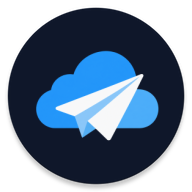
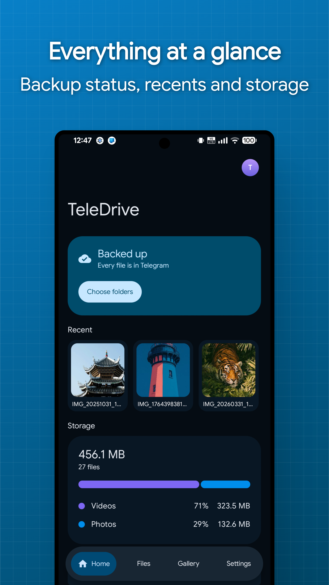
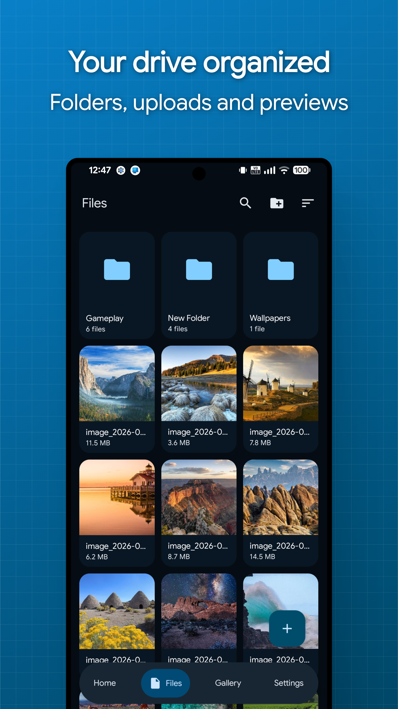
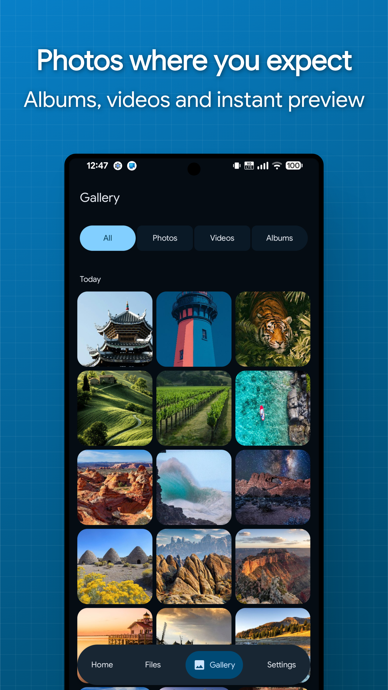
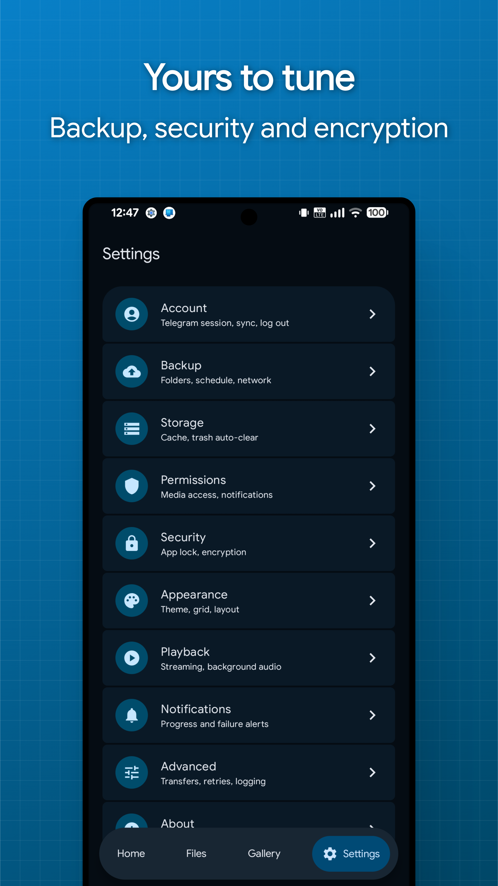

<p align="right"><a href="README.md">English</a></p>

<div align="center">



# TeleDrive

Respalda y explora tus archivos usando un canal privado de Telegram como almacenamiento.

[](#requisitos)
[](#requisitos)
[](#requisitos)
[](#requisitos)
[](https://kotlinlang.org)
[](https://www.jetbrains.com/compose-multiplatform/)
[](https://github.com/Mahmud0808/TeleDrive/releases/latest)
[](https://github.com/Mahmud0808/TeleDrive/releases)
[](LICENSE)
<br><br>
<a href="https://www.buymeacoffee.com/DrDisagree"></a>
</div>

---

## Contenido

- [Acerca de](#acerca-de) · [Funciones](#funciones) · [Capturas de pantalla](#capturas-de-pantalla)
- **Instalación**: [Windows](#windows) · [Linux (x86_64)](#linux-x86_64) · [macOS (Apple Silicon)](#macos-apple-silicon) · [Android](#android)
- [Requisitos](#requisitos) · [Primeros pasos](#primeros-pasos) · [Empaquetar la app de escritorio](#empaquetar-la-app-de-escritorio)
- [Traer archivos existentes](#traer-archivos-existentes) · [Conviene saber](#conviene-saber)
- [Arquitectura](#arquitectura) · [Modelo de seguridad](#modelo-de-seguridad) · [Pruebas](#pruebas)
- [Contribuir](#contribuir) · [Licencia](#licencia)

---

## Acerca de

TeleDrive guarda tus archivos en un canal privado de Telegram de tu propia cuenta.
No hay servidor de TeleDrive ni cuenta que crear con nosotros. La app mantiene un
índice local para que explorar y buscar sigan siendo rápidos y funcionen sin conexión.

Una sola base de código con Compose Multiplatform compila la app de Android y las
apps de escritorio de Windows, Linux x86_64 y macOS. Comparten el motor de
almacenamiento, el cifrado, las transferencias y toda la capa de UI, y todas
exploran la misma unidad.

## Funciones

- **Respaldo automático**: las fotos y las carpetas elegidas se suben solas en Android, con programación, reglas de Wi-Fi y de carga, y patrones de exclusión
- **Sin límite de tamaño de archivo**: un video de 20 GB es un solo archivo en la app, sin importar el límite por mensaje de Telegram
- **Cifrado**: AES-256-GCM opcional para el contenido de los archivos, sus nombres, los pies de foto y el árbol de carpetas
- **Gestión de archivos**: carpetas, favoritos, elementos ocultos y archivados, papelera y acciones masivas
- **Streaming**: el video y el audio se reproducen directo desde Telegram, con búsqueda por posición, incluidos los archivos cifrados
- **Vistas previas**: imágenes, PDFs, texto y contenido de ZIP se abren integrados
- **Múltiples unidades**: canales separados para lo personal, el trabajo o las fotos en una misma cuenta
- **Compartir**: los archivos llegan desde la hoja de compartir de Android, y los bytes idénticos nunca se suben dos veces
- **Transferencias**: cola en paralelo con pausa y reanudación que sobrevive a reinicios
- **Recuperación**: reinstalas, inicias sesión, escribes tu frase de contraseña y la unidad entera vuelve
- **Seguridad del dispositivo**: bloqueo de la app con biometría, bloqueo de capturas de pantalla y una caché local cifrada

## Capturas de pantalla

<div align="center">
   
</div>

## Instalación

### Windows

Descarga `TeleDrive-<version>.msi` desde la [página de releases](../../releases) y
ejecútalo. Se instala por usuario sin pedir permisos de administrador, agrega
accesos directos al menú Inicio y al escritorio, y se desinstala desde
Configuración de Windows. Tu sesión y tus ajustes viven en `%APPDATA%\TeleDrive`
y sobreviven a las reinstalaciones.

### Linux (x86_64)

Descarga desde la [página de releases](../../releases). Todo va incluido, así que
no hay nada más que instalar.

**AppImage** (la mayoría de las distros desde 2022 o más nuevas)

1. Descarga `TeleDrive-<version>-x86_64.AppImage`.
2. Dale permiso de ejecución: clic derecho → **Propiedades** → **Permitir ejecutar como
   programa**, o `chmod +x TeleDrive-<version>-x86_64.AppImage`.
3. Haz doble clic sobre él.

**.deb** (Ubuntu 24.04, Debian 13 o más nuevas)

```bash
sudo apt install ./teledrive_<version>_amd64.deb
```

Luego abre TeleDrive desde el menú de aplicaciones.

### macOS (Apple Silicon)

Descarga `TeleDrive-<version>.dmg` desde la [página de releases](../../releases),
ábrelo y arrastra TeleDrive a Aplicaciones. La compilación es solo para Apple
Silicon, porque la librería nativa de Telegram que usa la app no tiene versión
para Mac Intel.

La app no está firmada con un Apple Developer ID, así que Gatekeeper la bloquea
en el primer arranque. Quita la marca de cuarentena una vez y de ahí en adelante
abre normalmente:

```bash
xattr -dr com.apple.quarantine /Applications/TeleDrive.app
```

Tu sesión y tus ajustes viven en `~/Library/Application Support/TeleDrive`.

La vista previa de medios funciona de fábrica. Igual que en Windows, la app
incluye su propia copia de libVLC, así que no hay nada más que instalar. Si
llega a fallar al cargar, se usa un VLC de `/Applications` y, si tampoco lo hay,
la app igual abre, explora, sube y descarga, con la vista previa recurriendo a
abrir el archivo con tu aplicación predeterminada.

### Android

Toma un APK de la [página de releases](../../releases). Las compilaciones vienen
separadas por arquitectura de CPU, así que elige la que coincida con tu dispositivo:

| APK | Úsalo cuando |
| --- | --- |
| `TeleDrive-<version>-arm64-v8a-release.apk` | Casi cualquier teléfono de los últimos años |
| `TeleDrive-<version>-armeabi-v7a-release.apk` | Dispositivos de 32 bits más viejos |
| `TeleDrive-<version>-x86_64-release.apk` | Emuladores de 64 bits y Chromebooks con x86 |
| `TeleDrive-<version>-x86-release.apk` | x86 de 32 bits, raro fuera de emuladores viejos |
| `TeleDrive-<version>-universal-release.apk` | No estás seguro, o haces sideload en algo atípico |

El universal lleva todas las arquitecturas a la vez, así que prefiere una
compilación específica salvo que necesites la alternativa. La mayor parte de ese
tamaño es TDLib, la librería oficial de Telegram sobre la que está construida la app.

## Requisitos

- Android 8.0 (API 26) o más nuevos, Windows 10+ de 64 bits, Linux x86_64, o
  macOS en Apple Silicon
- Una cuenta de Telegram
- Tus propias credenciales de la API de Telegram, gratuitas en
  [my.telegram.org](https://my.telegram.org) bajo *API development tools*

Para obtener las credenciales: inicia sesión en
[my.telegram.org](https://my.telegram.org), abre *API development tools* y
completa un nombre de app y un nombre corto. Cualquier cosa razonable sirve, y
la plataforma y la descripción no importan. La página después muestra un
**api_id** y un **api_hash**, que es lo que TeleDrive pide en el primer arranque.

Escribes el ID y el hash de la API al momento y quedan cifrados en el
dispositivo. No van incluidos dentro de la app, ni van a los registros, ni se
envían a ningún lado salvo a Telegram. Como son tuyos y no compartidos, tu uso
nunca se combina con el de nadie más, y un límite de peticiones de otra persona
no puede afectarte.

## Primeros pasos

```bash
git clone https://github.com/Mahmud0808/TeleDrive.git
cd TeleDrive
./gradlew :android:installDebug  # Android
./gradlew :desktop:run           # Escritorio de Windows/Linux
```

Luego, dentro de la app:

1. Escribe tu ID y hash de la API.
2. Inicia sesión, con el número de teléfono y el código de acceso, o eligiendo
   **Iniciar sesión con código QR**. Si Telegram está instalado en el mismo
   dispositivo, el paso del QR ofrece el botón **Confirmar en Telegram**, así
   que no hay que escanear nada.
3. Elige las carpetas para respaldar.
4. Opcionalmente, activa **Cifrar subidas** y establece una frase de
   contraseña de recuperación.

Las librerías nativas de TDLib vienen precompiladas en todas las plataformas: el
AAR de [`tdlibx/td`](https://github.com/tdlibx/td) vía JitPack en Android y
[tdlight](https://github.com/tdlight-team/tdlight-java) en escritorio (Windows,
Linux y macOS Apple Silicon), así que no hace falta un toolchain nativo. La
compilación toma el nativo que corresponde a la plataforma, por lo que un
paquete nunca lleva un conjunto sin usar.

### Empaquetar la app de escritorio

El empaquetado lo hace jpackage, y el runtime de Android Studio no lo incluye.
Apunta la compilación a un JDK completo con una propiedad `desktopJavaHome` en
tu `~/.gradle/gradle.properties` global, y luego:

```bash
./gradlew :desktop:packageMsi           # instalador de Windows
./gradlew :desktop:packageDebUser       # .deb de Linux con dependencias del sistema
./gradlew :desktop:packageAppImage      # AppImage de Linux, para cualquier distro
./gradlew :desktop:packageDmg           # imagen de disco de macOS
./gradlew :desktop:createDistributable  # carpeta de app portable
```

`packageDebUser` genera `desktop/build/deb/teledrive_<version>_amd64.deb`.
Incrusta un runtime JVM vía jlink y declara sus dependencias de Debian, así que
para el usuario final solo hace falta `sudo apt install
./teledrive_<version>_amd64.deb`. libVLC no va incluido en Linux: se trae como
dependencia del paquete.

`packageAppImage` genera
`desktop/build/appimage/TeleDrive-<version>-x86_64.AppImage` desde la misma
carpeta de app y empaca el libVLC instalado en la máquina de compilación junto
con las librerías que sus plugins necesitan. Ejecuta
[`desktop/packaging/linux/build-appimage.sh`](desktop/packaging/linux/build-appimage.sh),
que necesita `patchelf`, `desktop-file-utils`, los paquetes `libvlc5`,
`libvlccore9`, `vlc-plugin-base` y `vlc-plugin-video-output`,
[linuxdeploy](https://github.com/linuxdeploy/linuxdeploy) y
[appimagetool](https://github.com/AppImage/appimagetool). Pon los dos últimos en
el `PATH`, o pasa `-Plinuxdeploy=/ruta/a/linuxdeploy` y
`-Pappimagetool=/ruta/a/appimagetool`. Compila en la distro más vieja que
quieras soportar, porque las librerías incluidas definen la glibc mínima; las
compilaciones de release usan Ubuntu 22.04.

## Traer archivos existentes

¿Ya tienes archivos en un canal, un grupo o Mensajes guardados? Reenvíalos a la
unidad que creó TeleDrive y aparecerán en la app después de la próxima
sincronización. El reenvío ocurre en los servidores de Telegram, así que no se
descarga ni se sube nada de nuevo, y los archivos de cualquier tamaño llegan en
segundos.

Selecciona los mensajes en la app de Telegram, reenvíalos a tu canal de
TeleDrive y luego desliza hacia abajo para actualizar en TeleDrive.

Qué esperar de los archivos reenviados:

- Solo se toman los mensajes enviados **como documentos**. Una foto o un video
  enviado de la forma normal fue comprimido por Telegram en un mensaje de
  multimedia, y esos se omiten. Reenvía la versión de archivo original.
- **Los pies de foto se reemplazan.** TeleDrive guarda el nombre, la carpeta y
  las marcas de cada archivo en el pie de foto, así que el primer cambio de
  nombre, movimiento o paso por la papelera sobrescribe el texto que traía el
  mensaje.
- **No se registra checksum**, porque el archivo nunca se lee localmente. La
  detección de duplicados no puede coincidir con archivos reenviados, así que
  subir el mismo archivo después crea una segunda copia.
- Los archivos caen en la raíz de la unidad y quedan sin cifrar, porque ya
  estaban guardados así. Después muévelos a carpetas dentro de la app.

## Arquitectura

Kotlin Multiplatform con Clean Architecture y MVVM. La regla de dependencias es
`presentation -> domain <- data`, con `core` compartido por ambos lados. Ningún
tipo de TDLib sale de `core/telegram`. Casi todo vive en código común; cada
plataforma aporta solo lo que la otra no puede compartir, como los workers, el
Keystore, DPAPI o el almacén de claves de archivos del escritorio, y los shells
de la app.

```text
shared/               # KMP: motor de almacenamiento, crypto, sync, transferencias
├── commonMain/           # core, data, domain
├── jvmCommonMain/        # piezas JVM que las dos apps usan
├── androidMain/          # Keystore, MediaStore, pegamento de WorkManager
└── desktopMain/          # cliente tdlight, cifras de plataforma, schedulers de escritorio
ui/                   # KMP: todas las pantallas, el tema y los recursos de texto
├── commonMain/           # compose resources
└── jvmCommonMain/        # toda la capa de presentación
android/              # shell de Android: workers, notificaciones, reproductor media3
desktop/              # shell de Windows/Linux: ventana, empaquetado, puente de streaming
```

Stack: Kotlin Multiplatform, Coroutines, Compose Multiplatform, Material 3
Expressive, Koin, Room KMP, DataStore, WorkManager, Paging 3, Media3, Coil,
TDLib y tdlight.

## Modelo de seguridad

| Capa | Qué queda protegido |
| --- | --- |
| En el dispositivo | Las bases de datos de Room y TDLib selladas con una clave aleatoria envuelta por la plataforma (Android Keystore, Windows DPAPI o una clave de archivo local en Linux). Miniaturas y cachés cifradas con AES-GCM por defecto. |
| En Telegram | Con el cifrado activado, el canal guarda solo bytes sellados, nombres de archivo aleatorios, pies de foto cifrados y un árbol de carpetas cifrado. |
| Custodia de claves | Las claves de contenido son aleatorias, quedan envueltas por la clave maestra de la plataforma y nunca salen del dispositivo descifradas. |
| Recuperación | La clave de contenido se respalda en tu canal, sellada con tu frase de contraseña (PBKDF2, 310k iteraciones). Restaurarla en un dispositivo nuevo lo desbloquea todo. |

Quien lee el canal sin tu clave solo aprende la cantidad de archivos, los
tamaños y las marcas de tiempo. La frase de contraseña no tiene camino de
recuperación, y ese es el objetivo, así que pon una pista al crearla y no
incluyas la frase dentro de la pista.

## Conviene saber

- Un archivo que pasa el límite por archivo de Telegram se guarda como varios
  mensajes, así que abrirlo en la app de Telegram muestra las partes en vez del
  archivo completo. Solo TeleDrive lo vuelve a unir.
- El streaming autentica los cuadros que reproduce, no el archivo completo.
  Descargar verifica todo, así que úsalo cuando la integridad importa más que
  empezar rápido.
- Telegram no puede renombrar un documento dentro de un mensaje ya enviado, así
  que un cambio de nombre actualiza el manifiesto del pie de foto, que es lo
  que una reconstrucción del índice lee.
- TDLib no puede reanudar una subida de un solo mensaje, así que pausar una que
  cabe en un mensaje la reinicia. Una subida dividida se reanuda en la última
  parte completada, y las descargas siempre se reanudan.

## Pruebas

```bash
./gradlew testDebugUnitTest          # tests unitarios de crypto, respaldo de claves,
                                     # armado de consultas, decisiones de respaldo, nombres
./gradlew connectedDebugAndroidTest  # comportamiento del DAO de Room en un dispositivo
./gradlew :desktop:test              # grafo de DI de escritorio y costuras de plataforma
```

## Contribuir

Los issues y pull requests son bienvenidos. Mantén intacta la regla de
dependencias, sigue el estilo del código alrededor y agrega tests para los
cambios en los paquetes `domain` o `crypto` de `shared/`.

## Licencia

[Apache License 2.0](LICENSE).

TDLib es BSL-1.0. El envoltorio de Android precompilado (`tdlibx/td`) es Apache-2.0.

---

<div align="center">
<sub>TeleDrive es un proyecto independiente, sin afiliación con Telegram ni respaldo de Telegram.</sub>
</div>
